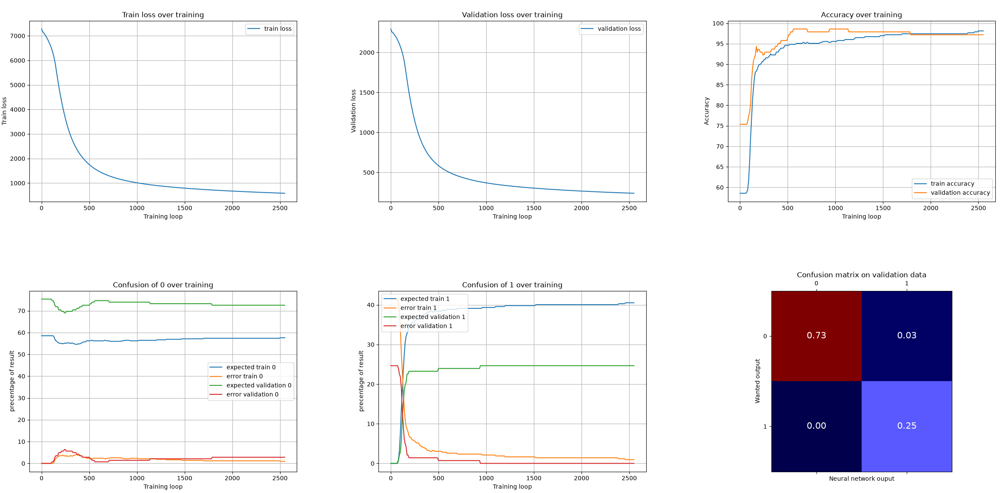
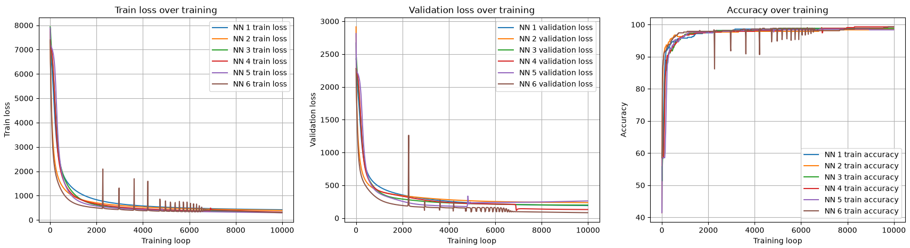

# 🧠 Multilayer Perceptron — Réseau de neurones from scratch

<p align="center">
  <strong>Perceptron multicouche codé from scratch pour diagnostiquer des cancers du sein (bénin / malin)</strong><br>
  Projet Machine Learning de l'école 42 | Python • NumPy • Matplotlib
</p>

---

## 📖 Vue d'ensemble

Ce projet est une introduction aux **réseaux de neurones artificiels**. L'objectif : implémenter entièrement à la main un **perceptron multicouche** (MLP) capable de prédire si une tumeur est **maligne (M)** ou **bénigne (B)**, à partir du dataset *Breast Cancer Wisconsin* (30 caractéristiques décrivant les noyaux cellulaires, extraites par ponction à l'aiguille fine).

Aucune bibliothèque de machine learning n'est utilisée : seule l'algèbre linéaire (**NumPy**) et l'affichage des courbes (**Matplotlib**) sont autorisés. Tout le reste est codé à la main :

1. **Propagation avant (feedforward)** — Calcul de la sortie du réseau couche par couche
2. **Rétropropagation (backpropagation)** — Calcul des gradients de la fonction de coût pour chaque poids et chaque biais
3. **Descente de gradient** — Mise à jour des paramètres pour minimiser l'erreur

---

## 🖼️ Screenshots


*Courbes de loss, d'accuracy, de confusion et matrice de confusion à la fin de l'entraînement*


*Comparaison de plusieurs architectures de réseau sur les mêmes graphiques*

---

## ✨ Fonctionnalités

### Partie obligatoire

- ✅ **Perceptron multicouche modulaire** — Nombre de couches cachées et taille de chacune choisis en ligne de commande (3 couches cachées de 8 neurones par défaut)
- ✅ **Séparation du dataset** — Script dédié pour découper les données en un jeu d'entraînement et un jeu de validation
- ✅ **Prétraitement des données** — Parsing du CSV avec vérification des erreurs et normalisation de chaque caractéristique
- ✅ **Entraînement** — Rétropropagation et descente de gradient, avec sauvegarde de la topologie et des poids du modèle
- ✅ **Prédiction / validation** — Chargement du modèle sauvegardé et évaluation sur un jeu de données
- ✅ **Courbes d'apprentissage** — Loss et accuracy (entraînement et validation) affichées à la fin de l'entraînement
- ✅ **Fonction de coût** — Entropie croisée binaire (*binary cross-entropy*)

### Bonus implémentés

- 🛑 **Early stopping** — Arrêt automatique de l'entraînement quand la loss de validation stagne
- 📊 **Plusieurs métriques** — Loss, accuracy, taux de bonnes/mauvaises prédictions par classe et matrice de confusion
- 📈 **Historique des métriques** — Suivi de toutes les métriques tout au long de l'entraînement
- 🔬 **Comparaison de modèles** — Script qui entraîne 12 architectures différentes et superpose leurs courbes sur les mêmes graphiques

---

## 🎮 Utilisation

### Installation

Prérequis : **Python 3.9+**

```bash
# Cloner le dépôt
git clone https://github.com/agtdbx/multilayer-perceptron.git
cd multilayer-perceptron

# Créer et activer un environnement virtuel
python3 -m venv .venv
source .venv/bin/activate

# Installer les dépendances
pip install -r requirements.txt
```

### 1. Séparer le dataset

```bash
python3 splitData.py <data.csv> <pourcentage_entrainement>
```

| Argument | Description |
|----------|-------------|
| `data.csv` | Chemin (relatif ou absolu) vers le dataset |
| `pourcentage_entrainement` | Part des données utilisée pour l'entraînement (entre 0 et 100) |

Exemple : `python3 splitData.py data.csv 80` génère `trainingData.csv` (80 %) et `validationData.csv` (20 %).

### 2. Entraîner le réseau

```bash
python3 training.py [couches_cachées]
```

`couches_cachées` est optionnel : une liste d'entiers strictement positifs séparés par des virgules.

```bash
python3 training.py            # 3 couches cachées de 8 neurones (par défaut)
python3 training.py 16,16      # 2 couches cachées de 16 neurones
python3 training.py 32,16,8,4  # 4 couches cachées de tailles décroissantes
```

L'entraînement affiche une barre de progression avec la loss et l'accuracy courantes, sauvegarde le modèle dans `.NNparams`, puis ouvre les graphiques d'apprentissage.

### 3. Valider le modèle

```bash
python3 validation.py
```

Charge le modèle sauvegardé, prédit sur `validationData.csv` et affiche le nombre d'erreurs, le taux d'erreur et la précision.

### 4. Comparer des architectures

```bash
python3 compare.py
```

Entraîne successivement chaque architecture listée dans `COMPARE_LAYERS` (fichier `define.py`) et affiche leurs courbes sur les mêmes graphiques.

### Configuration

Les hyperparamètres se règlent dans `define.py` :

| Paramètre | Valeur par défaut | Rôle |
|-----------|-------------------|------|
| `HIDDEN_LAYERS` | `[8, 8, 8]` | Couches cachées par défaut |
| `LEARNING_RATE` | `0.1` | Pas de la descente de gradient |
| `LEARNING_LOOP` | `10000` | Nombre maximal d'itérations |
| `EARLY_SAME_LIMIT` | `30` | Nombre de mesures sans amélioration avant l'arrêt anticipé |
| `EARLY_SAME_PRECISION` | `0.5` | Amélioration minimale de la loss pour être considérée comme un progrès |
| `SEED` | `None` | Graine aléatoire (`None` = aléatoire, un entier = résultat reproductible) |
| `COMPARE_LAYERS` | 12 architectures | Architectures testées par `compare.py` |

---

## 🧠 Aspects techniques

### Propagation avant

Pour chaque couche `l`, la sortie est calculée à partir de celle de la couche précédente :

```text
Z[l] = W[l] · A[l-1] + b[l]
A[l] = sigmoid(Z[l])
```

Les données sont organisées en matrices (caractéristiques × exemples) : tout le jeu de données traverse le réseau en une seule opération matricielle, sans boucle sur les exemples.

### Rétropropagation

Avec une sortie sigmoïde et une entropie croisée binaire, le gradient sur la couche de sortie se simplifie en `dZ[L] = A[L] - Y`. L'erreur est ensuite propagée vers les couches précédentes grâce à la règle de la chaîne :

```text
dW[l] = (1/m) · dZ[l] · A[l-1]ᵀ
db[l] = (1/m) · Σ dZ[l]
dZ[l-1] = W[l]ᵀ · dZ[l] ⊙ A[l-1] ⊙ (1 - A[l-1])
```

### Descente de gradient

Les paramètres sont mis à jour à chaque itération sur l'ensemble du jeu d'entraînement (*batch gradient descent*) :

```text
W[l] ← W[l] - α · dW[l]
b[l] ← b[l] - α · db[l]
```

### Fonction de coût

L'erreur est mesurée par l'entropie croisée binaire, avec un epsilon pour éviter `log(0)` :

```text
E = -(1/N) · Σ [ yₙ · log(pₙ) + (1 - yₙ) · log(1 - pₙ) ]
```

### Prétraitement

- **Normalisation** — Chaque caractéristique est divisée par son maximum calculé sur le jeu d'entraînement. Ces maximums sont sauvegardés avec le modèle et réutilisés à la validation, pour que les nouvelles données soient traitées exactement comme celles de l'entraînement.
- **Encodage des labels** — `B → [1, 0]` et `M → [0, 1]` : le réseau possède deux neurones de sortie, et la classe prédite est celle de plus forte activation.

### Sauvegarde du modèle

Le fichier `.NNparams` est un fichier texte lisible contenant, dans l'ordre : la topologie des couches cachées, les maximums de normalisation, puis les poids et biais de chaque couche.

### Visualisation

À la fin de l'entraînement, six graphiques sont affichés :

- Loss d'entraînement et loss de validation
- Accuracy d'entraînement et de validation
- Évolution des prédictions correctes et des erreurs pour chaque classe
- Matrice de confusion sur les données de validation

---

## 📂 Structure du projet

```text
multilayer-perceptron/
├── network/
│   ├── neuralNetwork.py   # Réseau : propagation avant, rétropropagation, gradients
│   └── loss.py            # Entropie croisée binaire
├── parsing/
│   ├── file.py            # Lecture / écriture de fichiers
│   ├── parse.py           # Parsing du dataset et du modèle sauvegardé
│   ├── string.py          # Conversions de chaînes
│   └── print.py           # Affichage des erreurs
├── readme-data/           # Ressources du readme
├── data.csv               # Dataset Breast Cancer Wisconsin
├── define.py              # Constantes et hyperparamètres
├── splitData.py           # Séparation entraînement / validation
├── training.py            # Entraînement du réseau
├── validation.py          # Évaluation du modèle sauvegardé
├── compare.py             # Comparaison de plusieurs architectures
├── requirements.txt       # Dépendances Python
└── README.md              # Ce fichier
```

---

## 🎯 Objectifs pédagogiques (42)

Ce projet de l'école 42 vise à maîtriser :

- ✅ Le fonctionnement d'un réseau de neurones : feedforward, backpropagation, descente de gradient
- ✅ La manipulation des dérivées et de l'algèbre linéaire
- ✅ Le prétraitement et la compréhension d'un jeu de données
- ✅ L'évaluation d'un modèle (jeu de validation, loss, accuracy, matrice de confusion)
- ✅ La comparaison d'hyperparamètres et d'architectures

---

## 📦 Dépendances

- **Python 3.9+**
- [**NumPy**](https://numpy.org/) — Calcul matriciel
- [**Matplotlib**](https://matplotlib.org/) — Courbes d'apprentissage
- [**PyQt6**](https://pypi.org/project/PyQt6/) — Backend d'affichage de Matplotlib
- [**tqdm**](https://tqdm.github.io/) — Barre de progression

---

## 📚 Ressources utiles

- [Perceptron multicouche (Wikipédia)](https://fr.wikipedia.org/wiki/Perceptron_multicouche)
- [Rétropropagation du gradient (Wikipédia)](https://fr.wikipedia.org/wiki/R%C3%A9tropropagation_du_gradient)
- [Entropie croisée (Wikipédia)](https://en.wikipedia.org/wiki/Cross-entropy)
- [Formation Deep Learning – Machine Learnia](https://www.youtube.com/watch?v=XUFLq6dKQok&list=PLO_fdPEVlfKoanjvTJbIbd9V5d9Pzp8Rw)

---

## 📜 License

Projet pédagogique école 42 — Usage éducatif uniquement.

---

## 👥 Auteur
**Auguste Deroubaix** (agtdbx) 🔗 [GitHub](https://github.com/agtdbx) • 🎓 Étudiant 42
